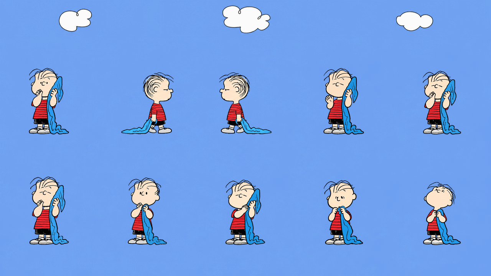

# Linus

[中文](README.zh-CN.md) · English

A little philosopher taking life slowly, blue blanket in tow. Big thoughts. Blanket firmly in hand.



A fan-made animated desktop companion inspired by Linus from *Peanuts*. The character description draws on his thoughtful, philosophical personality in the [official introduction](https://www.peanuts.com/about/linus); it is original copy, not a comic quotation. Artwork was made with AI assistance and refined into an animated sprite sheet.

## Download

Get the sprite sheet, individual animations, and Live Photo pairs from [Releases](https://github.com/Ian-Wuu/linus-blanket-pet/releases/latest).

- [Transparent sprite sheet](assets/spritesheet.png): the approved final artwork, unchanged.
- [Simultaneous GIF](previews/grid-sky.gif) · [MP4](previews/grid-sky.mp4)
- [Chinese description](assets/pet.zh-CN.json) · [English description](assets/pet.en.json)

For an app with the Pets integration enabled, attach `spritesheet.png` and ask it to import the v2 pet as **Linus**, using your preferred description. This repository is an asset pack, not a standalone desktop application. Copying files alone does not update an account pet.

The host currently exposes one description field, without a locale setting. `pet.json` contains both languages; the two language-specific files are alternatives for manual selection. They do not add automatic language switching.

## Motions

Idle, walk right, walk left, wave, little hop, blanket comfort, waiting, tending the blanket, checking the blanket, and sixteen look directions. The current preview shows all ten groups together on a blue sky background, without labels, in a 6.4-second preview. Clouds stay in a separate top band, clear of every animation frame. Each action uses the original approved preview timings, without the extra slowdown or cycle stretching. The GIF repeats the full preview; individual actions can restart at that boundary. Host app timing remains controlled by the app.

The v2 sheet is 1536 × 2288, with 192 × 208 cells, nine animation rows and two look rows (73 populated frames). Triggers and playback speed are controlled by the host. The look poses do not add physical mouse tracking by themselves.

## Live Photo

Keep the matching `Linus-Live.JPG` and `Linus-Live.MOV` together and import both into Apple Photos. The current sky-background version passed macOS Photos framework recognition. iPhone import/playback has not been tested. Live Photo files are in the release download; the MP4 works as an ordinary video.

## Rebuild previews

```sh
python3 -m pip install -r requirements.txt
python3 scripts/export-grid.py --sky
```

The sky version requires no font. Omit `--sky` to rebuild the older labeled previews; use `--font` to choose a font with Chinese glyphs. For a Live Photo pair, put a `video.mp4` and its matching `cover.png` in a directory, then run:

```sh
swift scripts/make-live-photo.swift /path/to/directory
```

The script writes a paired JPG/MOV and a Photos framework recognition report; it does not import anything into your library. The cover should match the video at 0.5 seconds.

Code: MIT, see [LICENSE](LICENSE). Linus and *Peanuts* are characters created by Charles M. Schulz; character artwork and associated rights are not included in the code license. This is an unofficial fan project.
