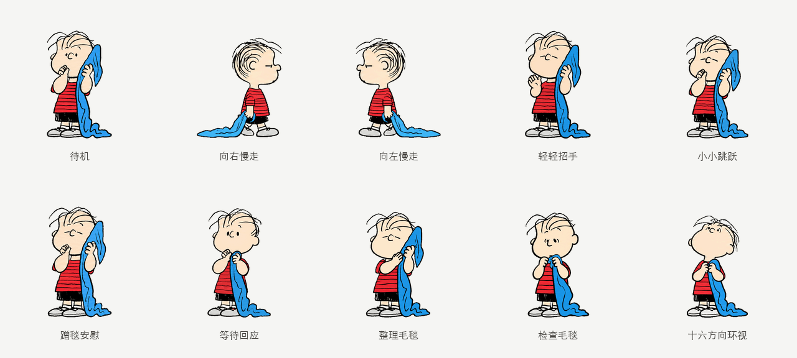

# Linus

中文 · [English](README.md)

拖着蓝毯子慢悠悠路过的小哲学家。道理想得很明白，毛毯还是不能放开。



以《花生漫画》（Peanuts）中的 Linus 为原型制作的同人桌宠。简介参考了[官方介绍](https://www.peanuts.com/about/linus)中爱思考、爱哲学的性格，是新写的文案，不是原作台词。图像由 AI 辅助生成，再整理、修整为动画图集。

## 下载与使用

在 [Releases](https://github.com/Ian-Wuu/linus-blanket-pet/releases/latest) 下载透明图集、单独动作和 Live Photo。

- [透明图集](assets/spritesheet.png)：已确认的最终画面，未改动。
- [同时播放 GIF](previews/grid-zh.gif) · [普通视频](previews/grid-zh.mp4)
- [中文简介](assets/pet.zh-CN.json) · [英文简介](assets/pet.en.json)

如果应用已启用 Pets 功能，附上 `spritesheet.png`，请它将这张 v2 图集导入为 **Linus**，并使用你选定的简介。本仓库是素材包，不是独立桌宠程序；仅复制文件不会更新账号中的宠物。

当前宠物接口只有一个简介字段，不支持按界面语言自动切换。`pet.json` 中是简短双语，另外两份配置方便手动选择中文或英文。

## 动作

待机、向右慢走、向左慢走、轻轻招手、小小跳跃、蹭毯安慰、等待回应、整理毛毯、检查毛毯，以及十六方向环视。预览采用两排五格，所有动作同时播放；12.8 秒循环，每组动作都播放完整周期。预览的节奏独立于应用内部的播放规则。

v2 图集为 1536 × 2288 像素，每格 192 × 208，共九行动作和两行环视，73 帧。实际触发条件和速度由应用控制；环视素材本身不会增加实体鼠标跟随功能。

## Live Photo

将同一文件夹中的 `Linus-Live.JPG` 和 `Linus-Live.MOV` 一起保留、一起导入苹果「照片」。中英文两版都已通过本机苹果 Photos 框架识别检查，尚未实测 iPhone 导入和播放。Live Photo 配对文件在 Release 下载包中；普通视频可直接播放。

## 重新导出

```sh
python3 -m pip install -r requirements.txt
python3 scripts/export-grid.py
```

默认使用 macOS 中文字体，其他系统通过 `--font` 指定支持中文的字体。Live Photo 脚本的用法见[英文说明](README.md#rebuild-previews)。

代码采用 [MIT 许可](LICENSE)。Linus 与 Peanuts 是 Charles M. Schulz 创作的角色；代码许可不包含角色形象及其相关权利。本项目为非官方同人制作。
